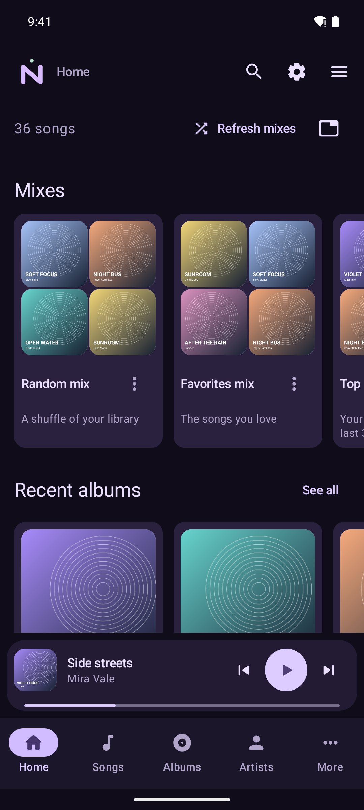
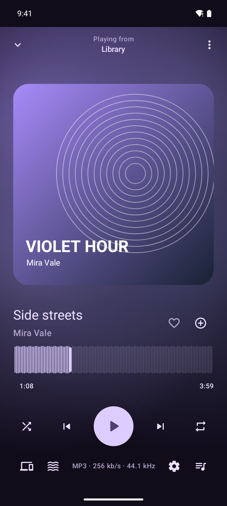
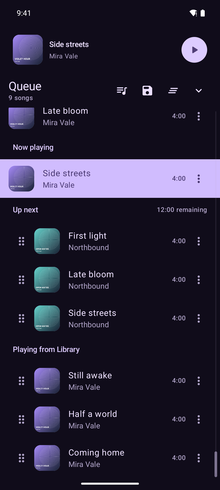
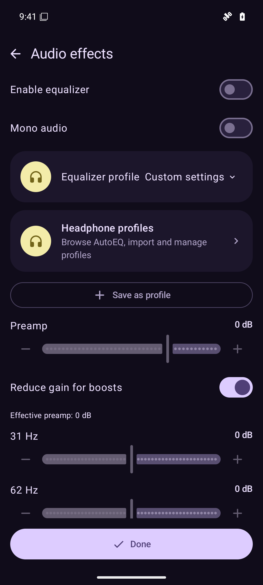

<h1>Manida</h1>

<p>
  <a href="https://github.com/D3SOX/Manida/releases">
    <picture>
      <source media="(prefers-color-scheme: dark)" srcset="https://manida-badges.withered-flower-f0f2.workers.dev/github-dark.svg">
      
    </picture>
  </a>&nbsp;
  <a href="https://manida.d3sox.me/fdroid/repo?fingerprint=FDEBFCB9DD790730FE607ACB8340588A839C44D9EA5BA6671AB3FAB83952F94B">
    <picture>
      <source media="(prefers-color-scheme: dark)" srcset="https://manida-badges.withered-flower-f0f2.workers.dev/fdroid-dark.svg">
      
    </picture>
  </a>&nbsp;
  <a href="https://apps.obtainium.imranr.dev/redirect?r=obtainium://app/%7B%22id%22%3A%22me.d3sox.manida%22%2C%22url%22%3A%22https%3A%2F%2Fgithub.com%2FD3SOX%2FManida%22%2C%22author%22%3A%22D3SOX%22%2C%22name%22%3A%22Manida%22%2C%22additionalSettings%22%3A%22%7B%5C%22includePrereleases%5C%22%3Atrue%2C%5C%22filterReleaseTitlesByRegEx%5C%22%3A%5C%22%5EManida%20%5B0-9%5D%2B%5B.%5D%5B0-9%5D%2B%5B.%5D%5B0-9%5D%2B%24%5C%22%7D%22%7D">
    <picture>
      <source media="(prefers-color-scheme: dark)" srcset="https://manida-badges.withered-flower-f0f2.workers.dev/obtainium-dark.svg">
      
    </picture>
  </a>&nbsp;
  <a href="https://manida.d3sox.me">
    <picture>
      <source media="(prefers-color-scheme: dark)" srcset="https://manida-badges.withered-flower-f0f2.workers.dev/archlinux-dark.svg">
      
    </picture>
  </a>
</p>

Manida is a music player for Android and Linux, built with Kotlin and Compose. It plays local files and connects to Navidrome and Subsonic-compatible servers.

Manida is in alpha. Features and file formats may change, and bugs are expected. Keep backups of your music files.

I started it because I couldn't find a music player with all the features I wanted. Namida came closest, but I didn't like its license. Manida is an independent implementation with a Material You interface, focused on local music and music servers.

## What it does

- Browse songs, albums, artists, genres and folders. Search the whole library and filter the results by type. Choose your library tabs, rearrange Home's sections and hide the sections you don't use.
- Manage playlists, smart playlists and M3U imports and exports. Publish playlists to your music server and keep their changes synced.
- Keep a separate Up next queue. Save queues with their played history, current song and playback position. Switch between live queues and snapshots, export them to playlists, and enable recovery snapshots if you want them.
- Download server music for offline playback. Match local and server copies of the same song instead of showing duplicates.
- Use gapless playback, crossfade, speed and pitch controls, repeat counts, an equalizer, mono audio and a sleep timer. Open common playback settings from Now playing. Browse AutoEQ headphone profiles or save your own settings as a profile.
- Show waveforms from the actual audio. Prepare a library in the background with bounded parallel decoding and a persistent cache.
- Edit local tags and artwork, or edit Navidrome's music files over SFTP. Find metadata through MusicBrainz.
- Track listening history and scrobble through your music server, Last.fm or ListenBrainz.
- Pair devices with a camera QR scan or a manual code. Sync playlists, favorites, ratings, listening history and saved queue contents. Playback positions stay separate on each device.
- Choose light, dark, system or artwork-based colors, including a custom color palette. Desktop has a volume slider in the mini player, right-click menus and MPRIS media controls.
- Run MilkDrop presets through projectM. Android has an in-app visualizer. Linux opens a separate window. The full original MilkDrop collection and projectM's Cream of the Crop pack ship offline: 10,347 presets and 67 textures, with search, collection and category filters, favorite presets, a favorites-only mode and automatic preset changes. Locked presets stay selected when you reopen the visualizer.

## Screenshots

These Android emulator screenshots use a fictional library.

| Home | Now playing | Queue | Audio effects |
| --- | --- | --- | --- |
|  |  |  |  |

## Platforms and servers

Android requires Android 12 or newer. APKs include arm64 and x86_64 native libraries. Linux packages target x86_64. MilkDrop needs OpenGL 3.3 on Linux or OpenGL ES 3.0 on Android.

The client uses the Subsonic REST API with token authentication, starting at API 1.13.0. Library discovery supports empty-search enumeration, album pagination and directory browsing. Streaming, downloads, playlists, favorites, ratings and scrobbling work through that API. Navidrome's native API is only used for remote file editing over SFTP.

Linux MilkDrop monitors Manida's audio stream through PulseAudio or PipeWire's PulseAudio service. It does not record the microphone or the mixed audio from other applications. Android feeds it directly from the playback pipeline.

## Install

The [release workflows](https://github.com/D3SOX/Manida/actions) produce APKs, Arch packages, portable Linux archives and AppImages. Published builds appear on [GitHub Releases](https://github.com/D3SOX/Manida/releases).

Manida's signed Android and Arch repositories run on GitHub Pages at [manida.d3sox.me](https://manida.d3sox.me).

### Android

Download an APK from [GitHub Releases](https://github.com/D3SOX/Manida/releases), [install with Obtainium][obtainium-install], or add [Manida's F-Droid repository][fdroid-repository]. The Obtainium link includes alpha releases and excludes development builds.

Scan this QR code in F-Droid to add the repository with its signing fingerprint:

<p align="center">
<a href="https://manida.d3sox.me/fdroid/repo?fingerprint=FDEBFCB9DD790730FE607ACB8340588A839C44D9EA5BA6671AB3FAB83952F94B">
  <picture>
    <source media="(prefers-color-scheme: dark)" srcset="packaging/fdroid-qr-dark.png">
    <source media="(prefers-color-scheme: light)" srcset="packaging/fdroid-qr-light.png">
    
  </picture>
</a>
</p>

To add it manually in F-Droid, paste this into the repository field:

```text
https://manida.d3sox.me/fdroid/repo?fingerprint=FDEBFCB9DD790730FE607ACB8340588A839C44D9EA5BA6671AB3FAB83952F94B
```

GitHub, Obtainium and this F-Droid repository distribute the same release APK and receive updates signed by the same app key. This is Manida's own repository; it is not a listing in the main f-droid.org repository.

### Arch Linux

Download the repository signing key in a terminal and check its fingerprint:

```sh
wget -O manida.asc https://manida.d3sox.me/manida.asc
gpg --show-keys --fingerprint manida.asc
```

It must match:

```text
5948 F17F 1611 CC2B 995B C612 1F0D 5421 26D5 14AB
```

```sh
sudo pacman-key --add manida.asc
sudo pacman-key --lsign-key 5948F17F1611CC2B995BC6121F0D542126D514AB
```

Add the repository with this terminal command:

```sh
sudo tee -a /etc/pacman.conf >/dev/null <<'REPO'

[manida]
SigLevel = Required DatabaseRequired
Server = https://manida.d3sox.me/arch/$arch
REPO
```

Install Manida, or update it with the rest of your system:

```sh
sudo pacman -Syu manida
```

The packages and repository database are signed. The public key is also available in [packaging/manida.asc](packaging/manida.asc).

You can install a downloaded Arch package directly:

```sh
sudo pacman -U ./manida-0.1.0-1-x86_64.pkg.tar.zst
```

### AppImage and portable archive

For an AppImage:

```sh
chmod +x ./manida-0.1.0-x86_64.AppImage
./manida-0.1.0-x86_64.AppImage
```

If FUSE is unavailable, run it with `APPIMAGE_EXTRACT_AND_RUN=1`. AppImages bundle the JVM, mpv, FFmpeg and the visualizer. The host supplies its C and C++ runtimes and graphics drivers. CI builds them on Ubuntu 24.04.

The portable archive bundles the JVM and projectM. Install mpv 0.40 or later, FFmpeg, libsecret, SDL2 and PulseAudio client tools on the host. A Secret Service provider, such as KDE's wallet service, stores server credentials.

Development APKs install separately as **Manida dev** and use the public development key in `packaging/development.keystore`. Linux development packages replace Manida and use the same local data directory.

## Build and test

Install JDK 21, Android SDK platform 37.0, build tools 37.0.0, NDK 28.2.13676358 and CMake 3.22.1. Linux also needs CMake, Ninja, SDL2 and OpenGL development files, mpv and its development library, FFmpeg, libsecret and PulseAudio client tools. Desktop distributions use JDK 25 for their bundled runtime.

Set `JAVA_HOME` to JDK 21 and `ANDROID_HOME` to your Android SDK. Gradle detects installed toolchains or reads `JAVA_HOME_21_X64` and `JAVA_HOME_25_X64`.

```sh
./gradlew :androidApp:assembleDebug
./gradlew :androidApp:assembleDevelopment
./gradlew :desktopApp:createDistributable
```

The first native build downloads checksum-verified projectM 4.1.8 and its evaluator. Subsequent builds reuse those sources. Native dependencies remain shared libraries.

The acceptance suite uses disposable Navidrome, gonic, SFTP and scrobbling fixtures. CI runs desktop tests and Android instrumentation on API 31 and API 36 with 16 KB memory pages. Release checks also install the optimized APK and open MilkDrop. The fixture helpers under `scripts/` can start the same services locally. Use an emulator for instrumentation tests, which clear the app's test data.

Pull requests run the app suites when app, build, fixture or app-packaging inputs change, including edits to the test workflow itself. Website-only PRs check JavaScript syntax and site packaging instead. CodeQL scans the languages affected by a change; scheduled and manual security scans cover every language. Release and manual acceptance runs always run both app suites.

```sh
./gradlew :shared:desktopTest
./gradlew :androidApp:connectedDebugAndroidTest
```

Desktop UI tests need a display, such as `xvfb-run`, and the audio-monitor test needs a PulseAudio-compatible service. `scripts/ci-tests.sh` starts and stops the complete fixture set on an isolated CI runner.

## Release setup

`development.yml` builds a development prerelease when app or build inputs change on `master`, or on a manual workflow run. Each development run uses its own `development-<run ID>` tag. Assets upload to a draft before publication, so development releases work with GitHub release immutability. Dependency submission runs when Gradle manifests or configuration change. `release.yml` publishes tagged alpha releases after acceptance tests pass. It attaches the signed Arch and F-Droid repositories as `manida-repositories.tar.gz` and then runs `website.yml`. `website.yml` also runs on pushes to `master` that change the landing page. It deploys the page together with the repositories from the newest release, so a website change doesn't need a new release. A release tag such as `v0.1.0` must match both platform versions. Update Android's `versionCode` for each Android release.

Configure these repository secrets and variables for signed releases:

| Name | Kind | Purpose |
| --- | --- | --- |
| `MANIDA_ANDROID_KEYSTORE_BASE64` | Secret | Base64-encoded release keystore |
| `MANIDA_ANDROID_KEYSTORE_PASSWORD` | Secret | Keystore password |
| `MANIDA_ANDROID_KEY_PASSWORD` | Secret | Signing-key password |
| `MANIDA_ANDROID_KEY_ALIAS` | Variable | Signing-key alias |
| `MANIDA_ARCH_SIGNING_KEY` | Secret | Armored private key for Arch packages |
| `MANIDA_ARCH_SIGNING_PASSPHRASE` | Secret | Arch signing-key passphrase |
| `MANIDA_ARCH_SIGNING_FINGERPRINT` | Variable | Full Arch signing-key fingerprint |
| `MANIDA_FDROID_KEYSTORE_BASE64` | Secret | Base64-encoded F-Droid repository keystore, alias `manida-fdroid` |
| `MANIDA_FDROID_KEYSTORE_PASSWORD` | Secret | F-Droid repository keystore and key password |

GitHub Pages uses GitHub Actions as its source, with `manida.d3sox.me` as the custom domain. Its DNS `CNAME` points to `d3sox.github.io`. Each deployment replaces the whole site, so the website workflow always includes the repositories from the newest release. F-Droid's landing page is `/fdroid`; its signed index and APKs are under `/fdroid/repo`. The `github-pages` environment must allow the `master` branch for website changes and release tags matching `v*`. Development builds do not require release signing secrets.

### README badges

The SVGs in `badges/public` are hosted by the `manida-badges` Cloudflare Worker. The README selects the light or dark variant to match the reader's theme. To publish badge changes, sign in to Cloudflare with Wrangler and run:

```sh
cd badges
bun install --frozen-lockfile
bun run check
bun run deploy
```

## License and credits

Manida uses [AGPL-3.0-only](LICENSE). Namida inspired the feature requirements. Manida does not include its implementation or assets.

MilkDrop rendering uses [projectM](https://github.com/projectM-visualizer/projectm/tree/4967dc003e5206d7df3ff447287f7609c47d2343), under LGPL-2.1-or-later. The desktop window follows the approach used by [Spotifast](https://github.com/crmne/spotifast). Third-party license notices ship with the native libraries. Release assets include the exact projectM, evaluator and mpv source archives used by the build.

The bundled presets and textures retain their upstream authorship and notices, including the [preset pack's distribution notice](https://github.com/projectM-visualizer/presets-cream-of-the-crop/blob/0180df21f5e0bd39b9060cc5de420ed2f1f9e509/LICENSE.md). `python scripts/package-milkdrop-presets.py` reproduces the library from checksum-verified source archives. Each app unpacks the library on first use and reuses it afterward.

The README badges use [Simple Icons](https://simpleicons.org/) and [Roboto](https://github.com/googlefonts/roboto-classic) lettering rendered as SVG paths.

[fdroid-repository]: https://manida.d3sox.me/fdroid/repo?fingerprint=FDEBFCB9DD790730FE607ACB8340588A839C44D9EA5BA6671AB3FAB83952F94B
[obtainium-install]: https://apps.obtainium.imranr.dev/redirect?r=obtainium://app/%7B%22id%22%3A%22me.d3sox.manida%22%2C%22url%22%3A%22https%3A%2F%2Fgithub.com%2FD3SOX%2FManida%22%2C%22author%22%3A%22D3SOX%22%2C%22name%22%3A%22Manida%22%2C%22additionalSettings%22%3A%22%7B%5C%22includePrereleases%5C%22%3Atrue%2C%5C%22filterReleaseTitlesByRegEx%5C%22%3A%5C%22%5EManida%20%5B0-9%5D%2B%5B.%5D%5B0-9%5D%2B%5B.%5D%5B0-9%5D%2B%24%5C%22%7D%22%7D
